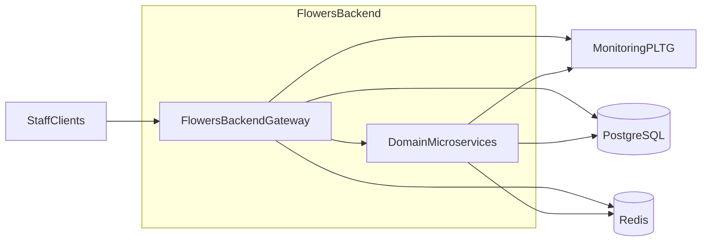
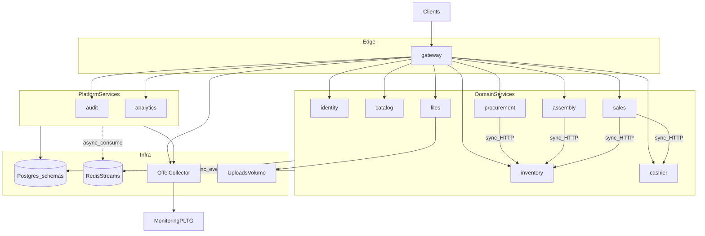
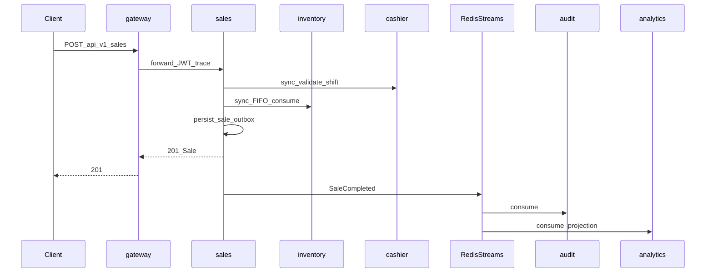
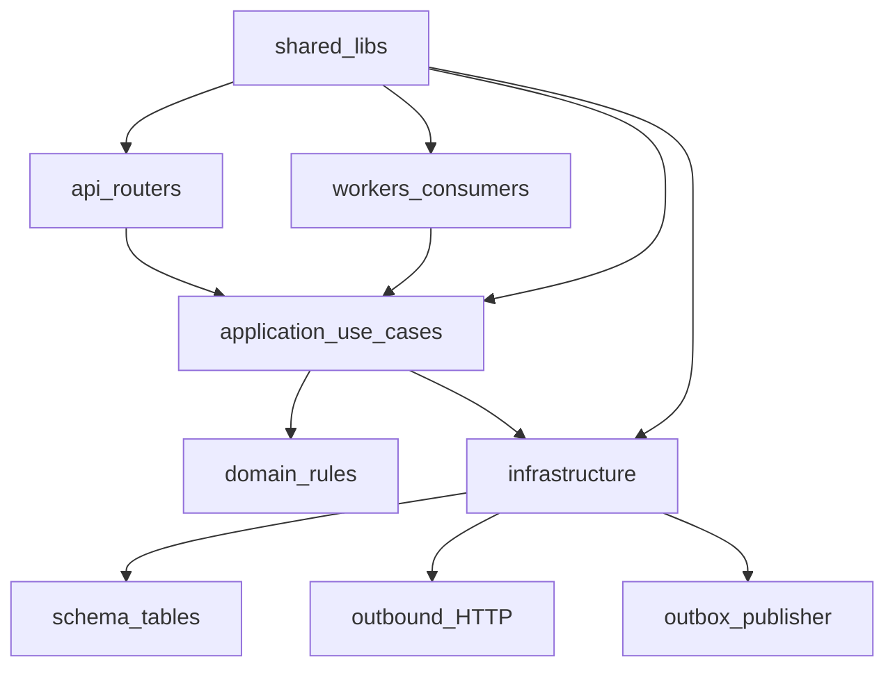

# Flowers Backend Architecture

Read this document before starting any new feature.

## 1. Goals and constraints

- Single-shop flower accounting MVP with path to multi-branch scale (~500 active staff).
- Microservices from day one, each service in its own Docker container.
- Deploy with Docker Compose on VPS (**no Kubernetes**).
- One PostgreSQL database, **one schema per service**.
- Sync HTTP only for consistency-critical interactive ACK; side-effects via async Redis Streams.
- Observability via OpenTelemetry → MonitoringPLTG.
- Interactive gateway latency SLO: **p95 < 0.5s**, **p99 < 1.5s**.
- Test coverage gate: **≥ 90%**.
- All config via environment variables; only `*.env.example` in git.

## 2. Context diagram



## 3. Container map



### Service → schema ownership

| Service | Schema | Responsibility |
|---|---|---|
| gateway | — | `/api/v1` edge, JWT validation, routing, rate limit |
| identity | identity | users, roles, permissions, object-level scopes, JWT issue |
| catalog | catalog | products, bouquet recipes |
| procurement | procurement | suppliers, supplies, partial acceptance |
| inventory | inventory | lots, FIFO, expiry, counts, write-offs |
| assembly | assembly | recipe/free assembly docs |
| sales | sales | sales, payments, refunds |
| cashier | cashier | shifts, reconciliations |
| files | files | attachment metadata + blob storage |
| audit | audit | append-only audit log |
| analytics | analytics | projections + MVP reports |

## 4. Sale path (sync ACK + async side-effects)



## 5. Service internal layers



### Import rules

- `api` → `application` (+ `schemas`)
- `application` → `domain`, infrastructure adapters
- `domain` must not import FastAPI / SQLAlchemy / Redis
- Cross-service imports of Python packages are forbidden — only HTTP or events

## 6. Sync vs async policy

### Sync budget

- Max **2 hops** after gateway for interactive ACK.
- Audit and analytics **must never** be on the sync response path.
- Prefer cache/read for shift validation when possible; stock consume remains sync.

### Modes

| Class | Mode | Examples |
|---|---|---|
| Interactive invariant command | Sync ACK | sale, FIFO consume, shift open/close, supply accept, assembly |
| Side-effects | Async Streams | audit, analytics projections |
| Bulk / heavy | `202 Accepted` + status | mass inventory, heavy report rebuild |
| Hot reads | Sync + Redis cache | product list, current shift |

### Domain events (MVP)

- `SaleCompleted`
- `StockChanged`
- `ShiftClosed`
- `SupplyAccepted`
- `UserRoleChanged`
- `WriteOffCompleted`
- `AssemblyCompleted`

Delivery: **at-least-once** via outbox/inbox; consumers must be idempotent.

## 7. Latency SLO

| Metric | Threshold | Scope |
|---|---|---|
| p95 | < 0.5s | interactive sync via gateway |
| p99 | < 1.5s | interactive sync via gateway |

Excluded: cold start, migrations, heavy analytics, large file uploads.

## 8. Compose environments

```bash
docker compose -f docker-compose.yml -f docker-compose.local.yml --env-file .env.local up --build
docker compose -f docker-compose.yml -f docker-compose.dev.yml --env-file .env.dev up -d --build
docker compose -f docker-compose.yml -f docker-compose.prod.yml --env-file .env.prod up -d --build
```

| Overlay | Purpose |
|---|---|
| local | bind-mounts, reload, ports exposed, DEBUG |
| dev | built images, restart, staging-like |
| prod | no source mounts, resource limits, only gateway published, OTel → MonitoringPLTG |

## 9. Repository layout

See `README.md`. Shared package lives in `shared/`. Each service under `services/<name>/` follows:

```
services/<name>/
  Dockerfile
  pyproject.toml
  alembic/            # if service owns schema
  app/
    main.py
    config.py
    api/v1/
    schemas/
    domain/
    application/
    infrastructure/
    workers/
  tests/
```

## 10. AuthN / AuthZ

- Admin creates employee accounts (no self-signup).
- JWT access + refresh issued by `identity`.
- Gateway validates JWT and forwards identity headers.
- Flexible RBAC: custom roles, permissions, **object-level** scopes on all domain objects.
- Service-to-service calls propagate trace context and caller identity.

## 11. Data invariants

- Sell only stock originating from supplies/assemblies with buy/sell prices.
- Lot consumption uses **FIFO**.
- Bouquet cost = sum of component buy prices at assembly time.
- Shift close stores expected vs actual → cash discrepancy.
- Expiry/wilting requires write-off act with 1..N photos.
- Products are **archived**, not hard-deleted.
- Currency RUB; timezone `Europe/Moscow`.
- Photos: jpeg/png/webp, ≤5MB, ≤10 per write-off.

## 12. Config and secrets

- Runtime settings only from env.
- Commit only `.env.example`, `.env.local.example`, `.env.dev.example`, `.env.prod.example`.
- Never commit real `.env*` with secrets.

## 13. API versioning

- Public edge: `/api/v1/...`
- Breaking changes require new version or deprecation window documented in FE API docs.

## 14. Testing and merge DoD

- Coverage ≥ 90% for shared + touched services.
- Unit tests for domain rules (FIFO, cost, RBAC).
- API tests per service.
- E2E through gateway for critical paths.
- Feature branch → merge into `backend` (use `feat/<name>` because Git cannot nest under existing `backend` ref).

## 15. Evolution path

- Partition hot services by `shop_id` / `warehouse_id`.
- Scale containers independently in Compose/prod.
- Replace Redis Streams with NATS/Kafka later without changing event contracts.
- Split Postgres only when operationally justified.

## 16. Mandatory pre-feature checklist

1. Re-read this architecture document.
2. Branch from `backend` as `feat/<short-name>`.
3. Keep sync budget and outbox rules.
4. Add/update tests to keep coverage ≥ 90%.
5. After FE-facing commit: add `docs/api/xx_<commit>_desc.md` + Postman update.
