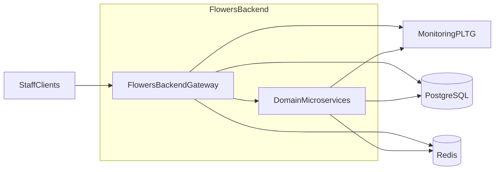
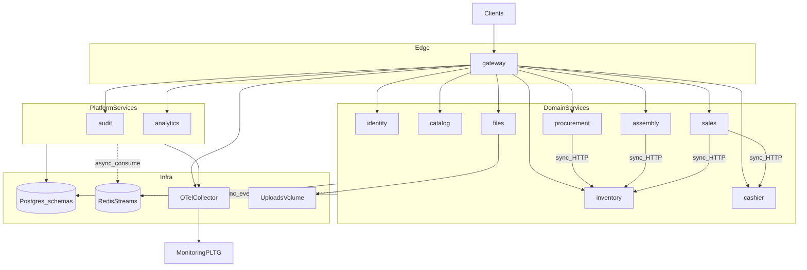
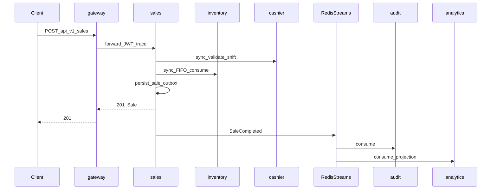
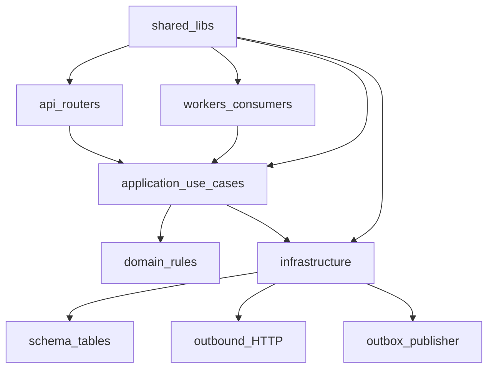

# Архитектура backend Flowers

Читайте этот документ перед началом любой новой фичи.

## 1. Цели и ограничения

- MVP учёта одиночного цветочного с путём к сети (~500 активных сотрудников).
- Микросервисы с первого дня, каждый сервис — отдельный Docker-контейнер.
- Деплой Docker Compose на VPS (**без Kubernetes**).
- Одна PostgreSQL, **одна schema на сервис**.
- Sync HTTP только для consistency-critical interactive ACK; побочные эффекты — async Redis Streams.
- Observability: OpenTelemetry → MonitoringPLTG.
- Latency SLO на gateway: **p95 < 0.5s**, **p99 < 1.5s**.
- Покрытие тестами **≥ 90%**.
- Все настройки через env; в git только `*.env.example`.

## 2. Context-диаграмма



## 3. Карта контейнеров



### Сервис → schema

| Сервис | Schema | Ответственность |
|---|---|---|
| gateway | — | `/api/v1`, JWT, routing, rate limit |
| identity | identity | пользователи, роли, права, object-level, JWT |
| catalog | catalog | номенклатура, рецепты букетов |
| procurement | procurement | поставщики, поставки, частичная приёмка |
| inventory | inventory | партии, FIFO, сроки, инвентаризация, списания |
| assembly | assembly | сборка по рецепту / свободная |
| sales | sales | продажи, оплаты, возвраты |
| cashier | cashier | смены, сверки |
| files | files | метаданные вложений + хранение |
| audit | audit | append-only журнал |
| analytics | analytics | проекции + отчёты MVP |

## 4. Путь продажи (sync ACK + async)



## 5. Слои внутри сервиса



### Правила импортов

- `api` → `application` (+ `schemas`)
- `application` → `domain`, adapters
- `domain` не импортирует FastAPI / SQLAlchemy / Redis
- Прямые импорты чужих сервисов запрещены — только HTTP или события

## 6. Политика sync / async

### Sync budget

- Максимум **2 hop** после gateway для interactive ACK.
- Audit и analytics **никогда** не в sync-пути ответа.
- Проверку смены по возможности через cache/read; списание стока — sync.

### Режимы

| Класс | Режим | Примеры |
|---|---|---|
| Интерактивная команда с инвариантом | Sync ACK | продажа, FIFO, смена, приёмка, сборка |
| Побочные эффекты | Async Streams | audit, аналитические проекции |
| Bulk / тяжёлое | `202` + status | массовая инвентаризация |
| Горячие чтения | Sync + Redis cache | каталог, текущая смена |

### События MVP

`SaleCompleted`, `StockChanged`, `ShiftClosed`, `SupplyAccepted`, `UserRoleChanged`, `WriteOffCompleted`, `AssemblyCompleted`.

Доставка: **at-least-once** (outbox/inbox); consumers идемпотентны.

## 7. Latency SLO

| Метрика | Порог | Scope |
|---|---|---|
| p95 | < 0.5s | interactive sync через gateway |
| p99 | < 1.5s | interactive sync через gateway |

Исключения: cold start, миграции, тяжёлая аналитика, большие upload.

## 8. Compose-окружения

```bash
docker compose -f docker-compose.yml -f docker-compose.local.yml --env-file .env.local up --build
docker compose -f docker-compose.yml -f docker-compose.dev.yml --env-file .env.dev up -d --build
docker compose -f docker-compose.yml -f docker-compose.prod.yml --env-file .env.prod up -d --build
```

| Оверлей | Назначение |
|---|---|
| local | bind-mount, reload, порты наружу, DEBUG |
| dev | собранные образы, staging-like |
| prod | без mount исходников, лимиты, наружу только gateway |

## 9. Структура репозитория

Пакет `shared/` подключается во все сервисы. Шаблон сервиса — в `architecture.md` §9.

## 10. AuthN / AuthZ

- УЗ сотрудников создаёт админ (без self-signup).
- JWT access + refresh выпускает `identity`.
- Gateway валидирует JWT и прокидывает identity headers.
- Гибкая RBAC + object-level на всех доменных объектах.

## 11. Инварианты данных

- Продажа только из стока поставок/сборок с ценами.
- Списание партий — **FIFO**.
- Себестоимость букета = сумма закупок компонентов.
- Закрытие смены фиксирует кассовый разрыв.
- Просрочка → акт списания с 1..N фото.
- Номенклатура только archive.
- RUB; `Europe/Moscow`.
- Фото: jpeg/png/webp, ≤5MB, ≤10 на акт.

## 12. Конфиг и секреты

Только env; в git — example-файлы.

## 13. Версионирование API

Публичный край: `/api/v1/...`. Ломающие изменения — новая версия или deprecation.

## 14. Тесты и DoD merge

Coverage ≥ 90%. Ветки фич: `feat/<name>` от `backend` (Git не позволяет вложенные `backend/feat-*` при существующей ветке `backend`).

## 15. Эволюция

Partition по магазину/складу, независимое масштабирование контейнеров, при необходимости смена брокера без смены контрактов событий.

## 16. Чеклист перед фичей

1. Перечитать этот документ.
2. Ветка `feat/<short-name>` от `backend`.
3. Соблюдать sync budget и outbox.
4. Держать coverage ≥ 90%.
5. После FE-facing commit: `docs/api/xx_<commit>_desc.md` + Postman.
